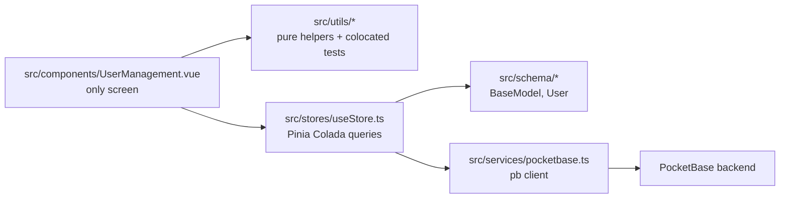
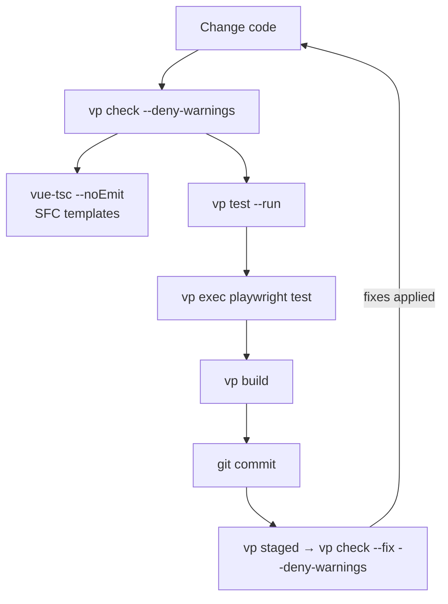

# AGENTS.md — repository rules for coding agents

> Companion to `README.md` (how to run the project) and `SKILLS.md` (which workflow
> skill to load). Read this **before** changing a file. Setup commands are not
> repeated here: see the README.

## Scope

Small fullstack app: one Vue 3 screen, one Pinia Colada store, one PocketBase
backend. Keep a change in the layer it belongs to. Do not add a second HTTP
client, a second state manager, a component library, or a second test runner.
Repository-wide policies live in `~/.config/opencode/AGENTS.md`; this file adds
only project-specific facts. If both apply, the stricter rule wins.

## Where to change what



| Area              | Files                                                    | Rule                                                    |
| ----------------- | -------------------------------------------------------- | ------------------------------------------------------- |
| Bootstrap / theme | `frontend/src/main.ts`                                   | PrimeVue 4 MIT registration; no license key entry point |
| UI                | `frontend/src/components/UserManagement.vue`             | Single screen; keep data access in the store            |
| Data access       | `frontend/src/stores/useStore.ts`                        | All queries/mutations go through the `pb` client        |
| Models            | `frontend/src/schema/BaseModel.ts`, `User.ts`            | Keep `toJSON()` prototype-safe                          |
| Pure logic        | `frontend/src/utils/*.ts`                                | Keep framework-free; test colocated as `*.test.ts`      |
| Backend           | `backend/Dockerfile.dev`, `entrypoint*.sh`, `fixtures/`  | Fixtures only in the dev entrypoint                     |
| Toolchain         | `frontend/vite.config.ts`, `.yarnrc.yml`, `package.json` | Vite+ owns scripts and catalogs                         |
| Host / containers | `devbox.json`, `docker-compose.*.yml`, `.vite-hooks/`    | Devbox = host tools; Compose = app runtime              |

`pb` is the most depended-on symbol: change `services/pocketbase.ts` deliberately
and re-run the full validation, not just a unit test.

## Invariants — do not break silently

1. **Licensing.** PrimeVue stays on `4.5.5`, `@primeuix/*` on `2.x`, `primeicons`
   on `7.x`. PrimeVue 5 moved to the PrimeUI license. Never upgrade those three
   without an explicit licensing decision from the user.
2. **Toolchain.** Use `vp install`, `vp add`, `vp run` and `vp exec` from
   `frontend/`. Do not call bare `yarn`/`npm` for scripts or dependencies: the
   catalogs and the Vite core resolution live in `.yarnrc.yml`. Keep Node
   `24.22.3` and Yarn `4.11.0`. Do not reintroduce Husky, ESLint, Prettier,
   lint-staged or a standalone Oxlint config.
3. **Type checking.** `vp check` uses tsrs (beta) for `.ts` and `vue-tsc` for
   `.vue` templates. Both are required; tsrs alone does not check SFC templates.
4. **Root-level TS configs.** `playwright.config.ts` is outside the `include` of
   `frontend/tsconfig.json`, so Node globals are not visible when it is checked
   on its own. Add `/// <reference types="node" />` to such a file instead of
   widening the project tsconfig.
5. **E2E isolation.** Playwright specs mock PocketBase: they must not require a
   running backend or seeded data.
6. **Secrets.** `.env` is ignored and must never be committed. The admin password
   already travels as a Docker `ARG`; do not add new secret-bearing build args.
7. **Boundaries.** Devbox provides host commands only — no application runtime
   dependency belongs in `devbox.json`. Compose owns the containers.

## Validation

In a non-interactive shell, source the Vite+ env first (`. /root/.config/vite-plus/env`),
then work from `frontend/`. Run all of these before declaring a change done:

```bash
vp check --deny-warnings   # Oxfmt + Oxlint + tsrs; warnings are errors
vp run typecheck           # tsrs + vue-tsc (SFC templates)
vp test --run              # 6 unit tests
vp exec playwright test    # 2 Chromium E2E tests
vp build                   # Rolldown production build
```

`vp run ci` chains check + unit tests + build with caching; `vp test --since-last-run`
is only an accelerator for local iteration, never the final gate.



## Commits

- Conventional prefixes in English: `feat:`, `fix:`, `chore:`, `test:`, `docs:`.
- One concern per commit; stage explicitly, never `git add -A` blindly.
- If the pre-commit hook rewrites a staged file, inspect `git diff` and re-stage
  before retrying. Never bypass the hook with `--no-verify`.
- No push, rebase or amend of existing commits without an explicit request.
