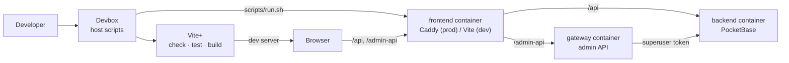

# Fullstack Vite/Vue 3/Typescript + Pinia-Colada + PocketBase Project

This repository contains a fullstack web application with a **Vue 3 frontend** and a **PocketBase backend**, fully containerized with Docker and orchestrated via Docker Compose. The frontend uses [Vite+](https://viteplus.dev/) (`vp`) as its single toolchain: Vite/Rolldown, Vitest, Oxlint, Oxfmt and Git hooks.

## Documentation map

| File        | Audience                                     | Answers                                                       |
| ----------- | -------------------------------------------- | ------------------------------------------------------------- |
| `README.md` | Everyone                                     | What the project is, how to run it, which commands exist      |
| `AGENTS.md` | Contributors and coding agents changing code | Where to change what, invariants, validation and commit rules |
| `SKILLS.md` | Coding agents                                | Which workflow skill to load for a given task                 |

The three files complement each other: commands are listed only here, rules only
in `AGENTS.md`, and workflow routing only in `SKILLS.md`.

---

## Project Structure

```
.
├── README.md
├── backend/
├── server/                     # admin gateway (superuser credentials stay here)
├── scripts/                    # setup-pb.mjs, run.sh
├── devbox.json / devbox.lock
├── docker-compose.dev.yml
├── docker-compose.prod.yml
├── .env.template
├── .vite-hooks/
└── frontend/
```

- `frontend/` – Vue 3 app (Vite + TypeScript)
- `backend/` – PocketBase with custom entrypoint and role/blocked hooks
- `server/` – Node gateway for admin-only operations; the only holder of superuser credentials
- `scripts/` – idempotent PocketBase setup and the mutually exclusive dev/prod launcher
- `docker-compose.dev.yml` / `docker-compose.prod.yml` – container orchestration for dev/prod
- `devbox.json` / `devbox.lock` – reproducible host toolchain (complements Docker Compose)
- `.vite-hooks/` – Vite+ Git hooks
- `.env.template` – Environment variables

## Runtime topology



The browser only talks to the frontend origin: Vite proxies in dev, Caddy in prod.
`connect-src` is restricted to `'self'`, so no backend URL or credential is shipped to the client.

Devbox is optional: without it, run the `vp` commands from `frontend/` and the
Compose commands from the repository root.

---

## Environment Variables

Create a `.env` file at the root of the project base on `.env.template`:

```env
# Frontend
FRONTEND_PORT=8080
FRONTEND_HMR_HOST=localhost

# Backend superuser (server-side only: backend entrypoint + admin gateway)
BACKEND_PORT=8081
BACKEND_ADMIN_EMAIL=
BACKEND_ADMIN_PASSWORD=

# Optional dev seed admin created by scripts/setup-pb.mjs
ADMIN_NAME=admin
ADMIN_EMAIL=admin@default-web.local
ADMIN_PASSWORD=dev-admin-1234
```

`BACKEND_ADMIN_*` is never read by the browser. The app signs in against the
`users` collection; admin roles and blocked flags are enforced by PocketBase rules/hooks.

---

## Requirements

- [Devbox](https://www.jetify.com/docs/devbox/installing-devbox) (`curl -fsSL get.jetify.com/devbox | bash`) — optional, provides the host toolchain (Node 24 + `vp` scripts)
- Node.js >= 22.22 (22.x), >= 24.11 or >= 26 — the project pins 24.22.3 in `frontend/package.json`
- [Vite+ CLI](https://viteplus.dev/guide) (`curl -fsSL https://vite.plus | bash`) — manages Node and Yarn 4 automatically
- [Docker](https://www.docker.com/)
- [Docker Compose](https://docs.docker.com/compose/)

---

## Running the stack

Use the root launcher; it always stops the other mode first, so dev and prod never run together.

```bash
scripts/run.sh dev     # dev stack: Vite + PocketBase + gateway, fixtures loaded
scripts/run.sh prod    # prod stack: built frontend on Caddy + PocketBase + gateway
scripts/run.sh down    # stop both modes
```

- Dev frontend: `http://localhost:${FRONTEND_PORT}` (8080 by default)
- Dev PocketBase: `http://localhost:${BACKEND_PORT}` (8081 by default)
- Prod: only the frontend port is published; `/api` and `/admin-api` are proxied by Caddy.
- In dev, `scripts/setup-pb.mjs` runs after the containers are healthy and creates the app admin user idempotently.

---

## Devbox (host tooling, alongside Docker Compose)

Devbox gives every developer the same host-side tools without touching the system installation.
It does not replace Docker Compose: use Compose for the frontend/backend containers and Devbox
for the local commands around them.

```bash
devbox shell          # enter the reproducible shell (installs Nix packages on first use)
devbox run setup      # install the Vite+ CLI, frontend deps and Chromium (once)
devbox run up         # scripts/run.sh dev (stops prod first)
devbox run prod       # scripts/run.sh prod (stops dev first)
devbox run dev        # frontend dev server on the host (needs backend from `up`)
devbox run check      # vp check --deny-warnings
devbox run test       # unit tests
devbox run test:affected  # only tests affected since the last run (Vitest 5.1)
devbox run e2e        # Playwright tests
devbox run ci         # cached vp run task: check + unit tests + build
devbox run down       # scripts/run.sh down (both modes)
```

---

## Frontend commands

Run these from `frontend/`:

```bash
vp dev                    # dev server
vp check                  # Oxfmt + Oxlint + tsrs type-check
vp check --deny-warnings  # same, warnings fail (CI / hooks)
vp test                   # unit tests (Vitest)
vp test --since-last-run  # only tests affected by recent changes
vpx tsrs --noEmit --fast  # fast standalone tsrs type-check
vp run typecheck          # tsrs + vue-tsc (SFC templates)
vp exec playwright test   # E2E tests (Chromium)
vp build                  # production build
vp run ci                 # cached check + unit tests + build
```

Install Chromium once before running E2E tests locally:

```bash
vp exec playwright install chromium
vp exec playwright install-deps chromium
```

## Pre-commit & Code Quality

Husky, lint-staged, ESLint and Prettier have been replaced by Vite+. The staged rules live in
`vite.config.ts` (`staged` block) and the project-owned hook is `.vite-hooks/pre-commit` at the
repository root. On a fresh clone, enable the dispatcher once from the repository root:

```bash
vp hooks enable
```

Every commit then runs `vp staged` → `vp check --fix --deny-warnings` on staged frontend files.

## Licensing

The frontend stays fully MIT: PrimeVue is pinned to the 4.5.5 line (with `@primeuix/*` 2.x and
`primeicons` 7.x). PrimeVue 5 moved to the PrimeUI license, so do not upgrade these three packages
without an explicit licensing decision.

Type checking uses [tsrs](https://github.com/oxc-project/tsrs) (beta, Rust port of TypeScript 7),
both through `vp check`/`vp run ci` and the standalone `typecheck` script. `vue-tsc` remains in the
same script because tsrs does not check `.vue` SFC templates yet.
