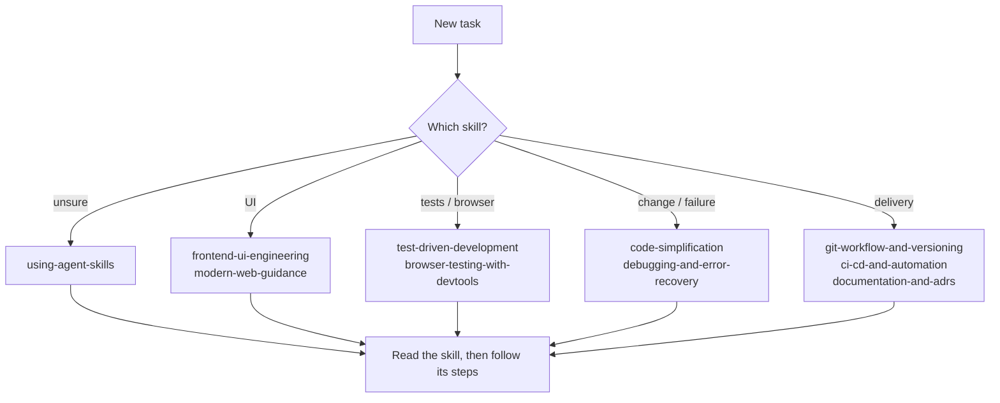

# SKILLS.md — agent workflow routing

> Companion to `README.md` (commands and setup) and `AGENTS.md` (project rules).
> This is a **router**, not a copy of the skill definitions.

## How skills work here

- Skills are installed globally under `~/.config/opencode/vendor/agent-skills/skills`
  and exposed through `opencode.jsonc`.
- Load a skill with the `skill` tool **before** planning or editing. A skill is a
  workflow to follow, not documentation to skim.
- Load one relevant skill at a time. If unsure which one applies, start with
  `using-agent-skills`.
- Ponytail rules are already active via the root `AGENTS.md`; no skill is needed
  for the "smallest complete change" mindset.

## Routing

| Trigger                                      | Load first                                                     | Why                                                              |
| -------------------------------------------- | -------------------------------------------------------------- | ---------------------------------------------------------------- |
| New or changed Vue UI, layout, accessibility | `frontend-ui-engineering`                                      | production-quality, accessible components                        |
| Standard HTML/CSS/DOM, forms, dialogs        | `modern-web-guidance`                                          | mandatory for platform APIs that change often                    |
| New util or bug fix                          | `test-driven-development`                                      | red → green test beside the source in `src/utils/`               |
| E2E spec or browser-only defect              | `browser-testing-with-devtools`, `test-driven-development`     | real DOM, console and network evidence                           |
| Refactor / cleanup                           | `code-simplification`                                          | smaller diff, unchanged behavior                                 |
| Build or test failure                        | `debugging-and-error-recovery`                                 | root cause instead of a silenced check                           |
| Dependency or toolchain change               | `source-driven-development`, `deprecation-and-migration`       | official-doc citation; respect the MIT constraint in `AGENTS.md` |
| Risky or irreversible choice                 | `doubt-driven-development`                                     | surface assumptions and failure modes                            |
| Vague feature request                        | `idea-refine` / `interview-me`, then `spec-driven-development` | sharpen intent before code                                       |
| Large feature                                | `planning-and-task-breakdown`, `incremental-implementation`    | thin verifiable slices                                           |
| Commit / PR                                  | `git-workflow-and-versioning`                                  | atomic conventional commits                                      |
| CI or Git hook change                        | `ci-cd-and-automation`                                         | keep the `vp run ci` + `vp staged` gates coherent                |
| Docs or architecture decision                | `documentation-and-adrs`                                       | update the right companion file, or record an ADR                |
| OpenCode config / plugin question            | `opencode`                                                     | verified against current OpenCode behavior                       |

`browser-testing-with-devtools` requires the Chrome DevTools MCP server to be
configured; if it is unavailable, fall back to the Playwright suite described in
the README and say so.

## Not relevant yet

- `observability-and-instrumentation` — no telemetry stack in this repo.
- `shipping-and-launch` — no in-repo production rollout beyond the Docker build.
- `performance-optimization` — load only with a measured Core Web Vitals or bundle
  regression; do not micro-optimize the three-chunk build preemptively.

When no row matches, do not invent a workflow: follow `AGENTS.md`, use the README
commands, and keep the change minimal.
